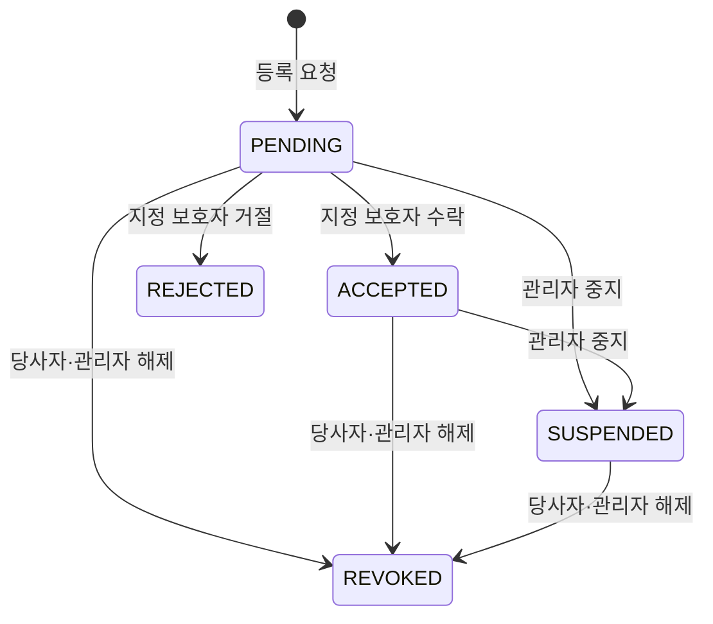

# 보호자 등록 API

기존 V1의 `guardian_registrations`와 `users`를 사용합니다. V1을 수정하거나 추가 마이그레이션을 만들지 않습니다.

develop의 Firebase 인증·보안 코드를 사용하고 `CurrentUser`가 인증된 UID를 DB 회원 ID로 변환합니다. [공통 연결 사항](shared-integration.md)을 참고하세요.

## API 목록

아래에서 사용자는 등록 요청자, 보호자는 요청 대상으로 지정된 회원입니다.

| 메서드 | 경로 | 업무 권한·상태 | 결과 |
|---|---|---|---|
| POST | /api/guardian-registrations | 사용자 → 본인 이외의 기존 회원 | PENDING 생성, 201 |
| PATCH | /api/guardian-registrations/{registrationId}/accept | 지정 보호자, PENDING | ACCEPTED, 200 |
| PATCH | /api/guardian-registrations/{registrationId}/reject | 지정 보호자, PENDING | REJECTED, 200 |
| PATCH | /api/guardian-registrations/{registrationId}/revoke | 사용자·보호자·관리자, PENDING·ACCEPTED·SUSPENDED | REVOKED, 200 |
| PATCH | /api/guardian-registrations/{registrationId}/suspend | 관리자, PENDING·ACCEPTED | SUSPENDED, 200 |
| PATCH | /api/guardian-registrations/{registrationId}/permissions | 사용자 또는 관리자, ACCEPTED | 권한 변경, 200 |
| GET | /api/guardian-registrations/{registrationId}/permissions/check | 사용자·보호자·관리자 | 허용 여부, 200 |

등록 요청 본문은 `{"guardianId": 2}`입니다. 권한 수정 본문은 Boolean `canViewLocation`, `canViewStatus`, `canViewPersonalInfo` 세 값을 모두 포함합니다. DB에는 기존 SMALLINT 0/1로 저장합니다.

권한 확인 쿼리는 `permissionType=LOCATION|STATUS|PERSONAL_INFO`이고 응답은 `{"allowed": true}` 또는 false입니다. ACCEPTED이고 해당 권한이 켜져 있을 때만 true입니다. 관리자가 조회하더라도 결과를 무조건 true로 바꾸지 않습니다.

## 상태 변화

상태 변경은 트랜잭션과 행 잠금으로 처리합니다. 등록 요청 시 보호자가 users에 있는지 확인합니다. 같은 사용자·보호자 쌍은 상태와 관계없이 중복 등록하면 409, 자기 자신 등록은 400, 없는 대상은 404, 업무 권한 부족은 403입니다. 수락·거절은 관리자여도 지정된 보호자가 아니면 수행할 수 없습니다.

## 담당자 연결 사항

develop 인증 필터가 현재 권한 목록을 비워 두므로 관리자 중지와 관리자 우회 권한은 아직 사용할 수 없습니다. 검증된 `ROLE_ADMIN` 제공은 인증 담당자에게 맡기고 기존 보안 코드는 변경하지 않습니다.

위험 이벤트·S3 코드에는 의존하지 않으며 `feature/risk-event-media-s3`과 따로 병합할 수 있습니다.
