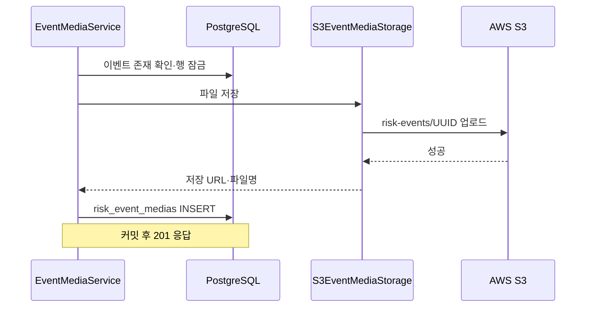

# 위험 이벤트·S3 미디어 API

기존 V1의 `risk_events`, `risk_event_medias`를 사용합니다. 귀가 세션은 이미 `safe_return_sessions`에 있어야 합니다. 위치 API나 V2는 포함하지 않습니다.

## 인증과 요청

develop의 Firebase 인증 코드와 보안 설정을 그대로 사용합니다. `Authorization: Bearer <ID_TOKEN>`으로 인증하고 `CurrentUser`가 UID를 `users.firebase_uid`와 연결합니다. [공통 연결 사항](shared-integration.md)을 참고하세요.

| 메서드 | 경로 | 업무 권한 | 결과 |
|---|---|---|---|
| POST | /api/risk-events | 세션 소유자 | PENDING 이벤트 생성, 201 |
| PATCH | /api/risk-events/{eventId}/status | 세션 소유자 또는 관리자 | 상태 변경, 200 |
| POST | /api/risk-events/{eventId}/medias | 관리자 | 파일 업로드·메타데이터 저장, 201 |
| GET | /api/risk-events/{eventId}/medias | 관리자 | 미디어 목록, 200 |
| DELETE | /api/risk-events/{eventId}/medias/{mediaId} | 관리자 | 파일·메타데이터 삭제, 204 |

이벤트 생성 요청은 `sessionId`(UUID), `eventType`(1~20자), `description`(1~500자), `detectedAt`(ISO 시각)입니다. 상태 변경 요청은 `status`(공백이 아닌 최대 20자)입니다. 현재 상태값 목록이나 전이 규칙은 제한하지 않습니다. 관리자라도 이벤트 생성 시에는 해당 세션의 소유자여야 합니다.

미디어 업로드는 multipart의 `file`, `mediaType`(1~20자)을 받습니다. 빈 파일은 400, 10MB 초과는 413입니다. 미디어 응답은 `id,eventId,mediaType,fileName,storageUrl,uploadedAt,createdAt,updatedAt`입니다.

## S3와 DB 흐름

실제 파일은 S3에 저장하고 URL은 `risk_event_medias.storage_url`에 기록합니다. 조회는 DB 메타데이터를 반환합니다. 업로드 후 DB가 롤백되면 파일 삭제를 시도합니다. 삭제는 S3 파일을 메모리에 보관한 뒤 S3·DB 순으로 삭제하고, DB가 롤백되면 파일 복원을 시도합니다. S3 읽기·삭제 오류가 나면 DB 행을 유지합니다.

## 실행 설정

- `AWS_S3_BUCKET`: 대상 S3 버킷 이름.
- `AWS_REGION`: 버킷 리전, 기본 `ap-northeast-2`.
- AWS SDK 기본 자격 증명 체인으로 인증합니다. 서버 IAM 역할 또는 실행 환경의 AWS 자격 증명을 사용합니다.
- 버킷의 `risk-events/*`에 `s3:PutObject`, `s3:GetObject`, `s3:DeleteObject` 권한이 필요합니다.
- 버킷 이름이 없으면 미디어 저장 작업은 503, 저장소 오류는 500입니다.
- DB와 Firebase 환경변수·실행 방법은 develop의 기존 설정을 사용합니다.

## 남아 있는 연결·운영 사항

1. develop의 인증 필터가 현재 관리자 권한을 전달하지 않으므로 관리자 미디어 API는 403입니다. 권한 제공은 인증 담당자가 연결합니다.
2. 실제 S3 버킷 연결은 배포 환경에서 확인해야 합니다. 비공개 파일을 앱에서 내려받을 임시 URL 기능은 포함하지 않습니다.
3. DB와 S3는 단일 트랜잭션이 아닙니다. 프로세스 종료나 롤백 후 파일 정리·복원 실패는 자동으로 복구되지 않으며, 실패 시 로그를 남깁니다.
4. 세션 생성·회원 가입은 해당 담당 모듈에서 완료되어야 합니다.

보호자 API 구현에 의존하지 않으며 `feature/guardian-registration-v1`과 따로 병합할 수 있습니다.
